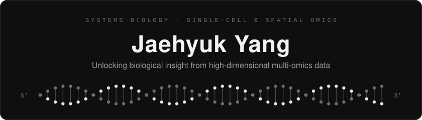

  

### About

**Bioinformatics undergraduate** at Chungnam National University  
**Research Intern** at KAIST · IBS Biomedical Mathematics Group (BIMAG)

I build analysis pipelines for **single-cell and spatial omics** —
 finding robust cell states, reliable clusters, and the genes that define them.

 

### Research Interests

`single-cell RNA-seq` &nbsp; `spatial transcriptomics` &nbsp; `spatial proteomics`  
`dimensionality reduction` &nbsp; `clustering reliability` &nbsp; `virtual cell`

 

### Tech Stack

 

### Bio Toolkit

### Tools

 

### Currently Exploring

  

### Contact

<!-- 필요한 것만 주석 해제하고 링크를 넣으세요

-->
 
Chungnam National University · Dept. of Bioinformatics &nbsp;|&nbsp; KAIST · IBS BIMAG

  

ATGC · from sequence to cell state

